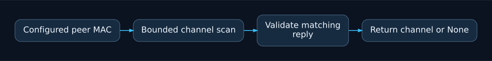

# ESP-NOW Automatic Channel Selection for MicroPython

A small peer-discovery helper maintained by Mateusz Sury. Run the bridge example
on one ESP32 and the reporting example on another using firmware with `network`
and `espnow` support. Record the board and MicroPython version when reporting
hardware results; host tests do not validate radio operation.

Copy `make_connection.py` to the reporting board. Configure the bridge's Wi-Fi
channel and replace the example six-byte peer MAC before running either device.

```python
from make_connection import make_connection
channel = make_connection(station, radio, peer, channels=range(1, 12))
if channel is None:
    print('Peer not found in this scan')
```

The caller activates the station and radio and registers the peer. The helper
performs one bounded scan, ignores replies from unrelated peers, and returns the
matched channel or `None`. The caller controls retries. Select only channels
permitted by the hardware and local regulations; the default legacy range 1–14
is not a statement that every channel is supported or legal everywhere.

* `example.py`: bridge, run on the first board.
* `reporting_device.py`: reporting loop, run on the second board.
* `python -m unittest -v`: host handshake tests using mocked radio I/O.

MIT license. No model or external service is required.

## Project overview

A bounded MicroPython peer-discovery helper for ESP-NOW devices on ESP32.



Host-tested handshake logic. Actual radio behavior depends on the board, firmware and permitted channels.
